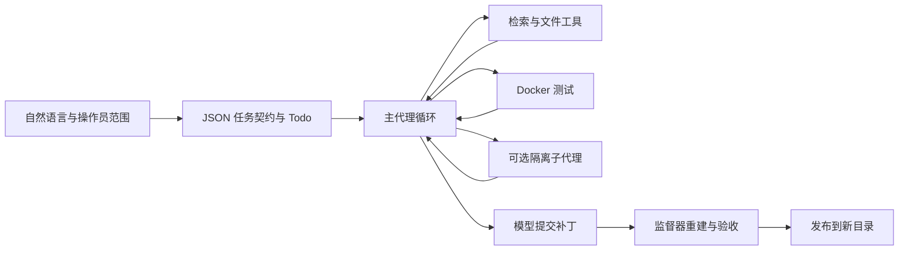

# RepoAgent

输入自然语言任务，在 Docker 隔离工作区内创建项目或修改已有代码；模型规划、调用工具、执行测试并主动提交，监督器独立重建补丁、验收并发布到新的目标目录。

本仓库为源码发行版，包含源码、配置模板、示例、测试及必要的第三方许可。不附带 API 密钥、私人文档、运行轨迹、实验结果、评测题目或模型文件。

## 核心设计

- **任务契约**：模型通过 `task_contract` 将需求转换为经过 Pydantic 校验的 JSON，包含需求、检查、指标和依赖计划。工作区与权限由调用方指定；模型提议的检查不能证明隐藏正确性。
- **工具接口**：统一 ToolRegistry 定义参数、权限、取消和输出边界；支持源码读取、锚点编辑、文件创建、结构化测试，以及显式配置的 MCP 工具。
- **上下文与记忆**：原始轨迹与请求视图分离；保护原始需求、近期修改和失败信息，按上下文与共享预算裁剪旧观察，提供归档回读；项目记忆支持 SQLite/BM25 与可选本地向量检索。
- **源码定位**：Python AST 定义、语法调用候选、文本引用及局部窗口检索，返回可解释排序分数与内容哈希；不是完整语义调用图。
- **受控协作**：最多两个不可递归的子代理，共享预算，隔离快照；主代理审阅结果、检查父版本冲突后集成，并重新测试。
- **交付校验**：模型提交与实际正确性分别记录。监督器从原始基线重建补丁并验证当前产物，检查通过后才发布，不覆盖输入仓库。



## 安装

需要 Python 3.10+ 与可用的 Linux Docker 引擎。以下 PowerShell 命令均在仓库根目录运行：

```powershell
python -m venv .venv
.\.venv\Scripts\python.exe -m pip install -r requirements.txt
Copy-Item .env.example .env
```

仅在本地 `.env` 填写 `DEEPSEEK_API_KEY`。推荐把默认模板复制成被忽略的本地配置，再设置开放平台实际提供的模型 ID、兼容参数和真实费率：

```powershell
Copy-Item runtime\API_PROVIDER_CURRENT.json config\provider.local.json
```

模板中的 `your-model-name` 必须替换。`pricing_usd_per_million` 为输入、输出、缓存命中估计单价，示例值不代表当前平台报价或账单。不同模型的 `reasoning_effort`、上下文容量和缓存计费应按所用接口设置。其他 OpenAI-compatible API 可在本地配置中修改 `base_url`、`api_key_env` 等字段。

首次使用，显式构建沙箱镜像；此步骤会下载基础镜像及工具依赖，不调用模型：

```powershell
docker build --target agent -f Dockerfile.sandbox -t repoagent-sandbox:local .
# 仅 HumanEval 官方评分需要第二个镜像
docker build --target scorer -f Dockerfile.sandbox -t repoagent-scorer:local .
```

实际任务执行时禁止自动拉取镜像，使用无网络、非 root、只读根文件系统和受限 CPU/内存的容器。不提供 Docker 故障时的宿主机执行回退。复杂仓库应自行准备包含其依赖的专用镜像，通过 `--image` 指定。

## 从零创建项目

先准备，不调用模型，也不执行测试：

```powershell
.\.venv\Scripts\python.exe -B run.py `
  --provider-config config\provider.local.json `
  --task "创建纯 Python 命令行计算器，支持加减乘除、负数、小数、除零报错及 --help。生成 calculator.py、README.md 和 unittest 测试，运行测试并修复后提交。" `
  --directory .\deliveries\calculator-01 --packet .\runs\calculator-01
```

检查准备结果后，运行同一任务配置；此命令会调用配置的模型，远程 API 产生费用：

```powershell
.\.venv\Scripts\python.exe -B run.py --run-packet .\runs\calculator-01
```

也可使用 `python run.py --provider-config config/provider.local.json --run` 交互输入任务及新交付目录。默认估算预算为 $0.10、600 秒、40 次请求、80 次工具调用和 600,000 Token；通过 `--usd`、`--seconds` 设置单任务费用估算上限与时限。费用控制依赖正确的费率配置。

目标目录必须尚不存在。工作区在 `runs/<task>/run/workspace`，模型实际产生的结构化需求在 `run/agent/task-contract.json`。`task.json` 是操作员配置，不等同于模型计划。失败保留状态，不发布失败产物，也不自动付费重跑。

## 修复已有仓库

```powershell
.\.venv\Scripts\python.exe -B run.py --run `
  --provider-config config\provider.local.json `
  --workspace ..\example-repository --directory .\deliveries\fixed-01 `
  --kind fix --task "修复这里描述的问题，增加相关回归测试，执行检查后提交" `
  --image repoagent-sandbox:local --usd 0.10 --seconds 600
```

原仓库作为输入，在独立副本中修改；提交指模型向监督器交付产物，不会自动执行仓库 Git commit 或 push。`--check "python -m unittest discover -s tests -v"` 可以绑定操作员固定检查。`--write-scope src tests` 可限制写范围，测试通过隔离的 `run_tests` 运行。

## 配置与扩展

- 本地模型：`--provider-config config/provider.local.example.json`，需要自行安装 Ollama 模型并配置上下文；不会自动下载。
- 子代理：默认只读/测试；`--allow-child-write` 允许申请受限写范围，主代理必须审阅、集成并重新测试。
- MCP：`--mcp-config config/mcp.example.json`，服务器命令在任务容器内执行，需自行准备服务与依赖；不继承模型密钥。
- 工具：实现 `Tool` 并通过 `ToolRegistry.register` 注册；入口插件可使用 `--tool-extension`。接口位于 `runtime/app/corecoder_mini/tools/`。
- 记忆：默认词法检索；`--memory-embedding ollama` 显式启用本地向量通道。基准任务禁用跨任务经验学习。
- 导出接口：`python run.py --export-tools schemas/tools.json`、`python run.py --export-schema schemas/task-intent.schema.json`。

## 可选评测接口

仓库仅包含适配器与原始官方评分源码，不附带题目、参考解、成绩、轨迹或历史补丁。

HumanEval 需要自行提供固定版本的官方题目文件，安装脚本先验证原始 SHA-256；不会自动触网：

```powershell
python scripts/prepare_humaneval.py --data-file <本地的HumanEval.jsonl.gz>
# 或显式允许脚本从固定官方上游下载：
python scripts/prepare_humaneval.py --download
python benchmark.py humaneval --ids HumanEval/0 --output runs/he-example `
  --provider-config config/provider.local.json `
  --image repoagent-sandbox:local --scorer-image repoagent-scorer:local
```

省略 `--run` 仅准备任务。只有公共 prompt 进入推理工作区，隐藏测试与参考解保留在评分侧；评分使用未修改的官方实现。

SWE-bench 通过 `python benchmark.py swebench --help` 查看接口；需要自行准备原始基线仓库、实例镜像、官方 `swebench==4.1.0` 评分环境及离线评分资产。当前适配器通过 Linux/WSL 运行官方评测，不包含自动下载和环境安装器。

`evaluate.py` 可对外部定位标注计算指标，使用 `--workspace`、`--cases`、`--output` 指定输入输出；本仓库不附带开发实验数据。

## 阅读源码与离线测试

```text
run.py → repoagent/cli.py → legacy_launcher.py → corecoder_mini/supervisor.py
    → worker.py → engine.py → native_model.py / tools / sandbox
repoagent/contracts.py        结构化需求与计划校验
repoagent/localization.py     AST、引用检索及候选排序
corecoder_mini/context_view.py / token_policy.py  请求视图与预算裁剪
corecoder_mini/project_memory.py / state_tools.py  项目记忆与工作状态
corecoder_mini/children.py / repoagent/child_permissions.py  子代理隔离与集成
repoagent/verification.py / corecoder_mini/delivery.py  测试凭据与交付
repoagent/benchmarks.py       官方评测适配器
```

所有 Python 包在 `runtime/app/`。上游源码与许可位于 `runtime/app/vendor/`，详见 [第三方说明](THIRD_PARTY_NOTICES.md)。

```powershell
.\.venv\Scripts\python.exe -m pip install -r requirements-dev.txt
.\.venv\Scripts\python.exe -B -m unittest discover -s tests -p test_launcher.py
Push-Location runtime\app
..\..\.venv\Scripts\python.exe -B -m pytest -q -m "not docker and not host_process" -p no:cacheprovider
Pop-Location
```

Docker 测试需显式运行；HumanEval 数据相关用例在未准备数据时跳过。项目不承诺任意任务必然修复成功，模型提议检查可能覆盖不足；恢复功能目前可导出与评分中断产物，不提供透明的模型会话续跑。

## 本地文件与上传边界

`.gitignore` 排除 `.env`、私钥、DOCX 等 Office 文档、`runs/`、`reports/`、`memory/`、数据集、压缩包和缓存。根目录仅提供 `.env.example`。运行会在本机产生状态、轨迹和检查结果，它们不是待发布源码；后续提交前仍应检查暂存列表。
